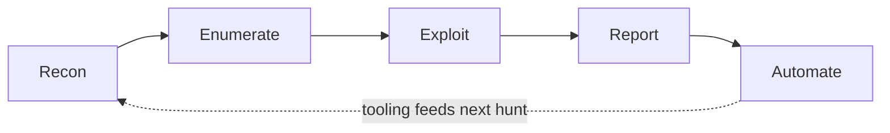

<!-- Cyber Terminal Profile: Chethan Yadav -->

<div align="center">
  
</div>

```text
   ____ _   _ _____ _____ _   _    _    _   _
  / ___| | | | ____|_   _| | | |  / \  | \ | |
 | |   | |_| |  _|   | | | |_| | / _ \ |  \| |
 | |___|  _  | |___  | | |  _  |/ ___ \| |\  |
  \____|_| |_|_____| |_| |_| |_/_/   \_\_| \_|
  offensive security  //  bug bounty  //  backend engineering
```

```bash
┌──(chethan㉿yadav)-[~]
└─$ whoami
> Offensive Security Learner | Bug Bounty Hunter | Developer

┌──(chethan㉿yadav)-[~]
└─$ cat about_me.txt
🕶️  Cybersecurity enthusiast diving deep into offensive security & vulnerability research
🧠  Loves breaking things (ethically) to understand them
🏆  Ranked Top 2% on TryHackMe
⚙️  Passionate about automation, red teaming & backend systems
⚡  Fun fact: I can survive 3 days without sleep during CTFs
🐔  Discord: everraaz
█
```

```json
// ~/profile.json
{
  "handle": "R4AZ",
  "role": ["bug bounty hunter", "backend engineer"],
  "focus": ["web app security", "recon automation", "red teaming", "vulnerability research"],
  "builds": ["CLI tooling", "security automation", "Telegram bots", "Chrome extensions"],
  "languages": ["Python", "Go", "TypeScript", "JavaScript", "Bash", "Java", "C"],
  "status": "hunting"
}
```

<h2 align="center">🧭 Methodology</h2>



<h2 align="center">💻 Arsenal</h2>

<div align="center">

| Layer | Stack |
|:--|:--|
| **Recon & Web** |    |
| **Exploitation** |  |
| **Languages** |      |
| **Backend & Infra** |      |

</div>

<h2 align="center">🛠️ Projects</h2>

```bash
└─$ ls ~/projects/security
```

<div align="center">

| Repo | What it does | Lang | Stars |
|:--|:--|:--|:--|
| [**ssh-2fa-hardening**](https://github.com/chethanyadav456/ssh-2fa-hardening) | Automation to harden Linux SSH with PAM-based Google Authenticator 2FA | Shell |  |
| [**AgentNetra**](https://github.com/chethanyadav456/AgentNetra) | See what your AI agents are really doing | Go |  |
| [**StegoSphere**](https://github.com/chethanyadav456/StegoSphere) | LSB steganography for encrypted hidden messages | Python |  |
| [**waybackurls**](https://github.com/chethanyadav456/waybackurls) | Historical URLs from the Wayback Machine, CLI and library | JavaScript |  |
| [**Cybersecurity-Conferences**](https://github.com/chethanyadav456/Cybersecurity-Conferences) | Curated list of 2026 cybersecurity conferences | Markdown |  |

</div>

```bash
└─$ ls ~/projects/engineering
```

<div align="center">

| Repo | What it does | Lang | Stars |
|:--|:--|:--|:--|
| [**hyderabad-tech-events**](https://github.com/chethanyadav456/hyderabad-tech-events) | Crowdsourced, auto-updated list of Hyderabad tech meetups | Python |  |
| [**tech-updates**](https://github.com/chethanyadav456/tech-updates) | Daily tech updates pushed to a Telegram channel | TypeScript |  |
| [**WinFlux**](https://github.com/chethanyadav456/WinFlux) | Windows cleanup, disk analysis and health reports from a CLI | Python |  |
| [**Skyplayr**](https://github.com/chethanyadav456/Skyplayr) | Universal Picture-in-Picture for Netflix and HTML5 players | JavaScript |  |
| [**JSON-Downloader**](https://github.com/chethanyadav456/JSON-Downloader) | One-click JSON download Chrome extension, no tracking | JavaScript |  |

</div>

<h2 align="center">🌐 Connections</h2>

<p align="center">
  <a href="https://tryhackme.com/p/R4AZ"></a>
  <a href="https://linkedin.com/in/chethanyadav"></a>
  <a href="https://x.com/0xChethan"></a>
  <a href="https://stackoverflow.com/users/18890241"></a>
  <a href="https://youtube.com/c/@AlgoRaaz"></a>
</p>

<div align="center">
  
</div>

<h2 align="center">📊 System Logs</h2>

<div align="center">
  
</div>

<br>

<div align="center">
  
</div>

<h2 align="center">💬 Hacker Quote</h2>

<div align="center">
  
</div>

<div align="center">
  
</div>
